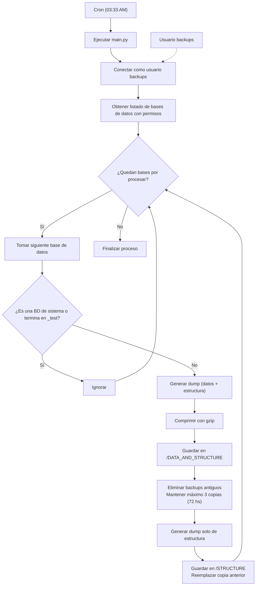

# POLICITA DE BACKUPS AUTOMATICOS Y FUNCIONAMINETO DEL CRON

## ESTRUCTURA DE CARPETAS
- `/CRON` Carpeta que contiene .env con las credenciales del usuario de backups, más el script main.py con el algoritmo de backup más /logs en caso de errores  
- `/STRUCTURE` Aqui se guardan los backups `<bd>.sql.gz` de unicamente las estructuras de las bases de datos sin datos
- `/DATA_AND_STRUCTURE` Aqui se guardan los backups `<bd>_<fecha>.sql.gz` propiamente dichos los cuales pueden importarse directamente 
- `/RUTINAS_TRIGGERS_EVENTOS` Es código sql ajustado a las bases de datos que le corresponden en sus respectivos ambientes /PROD y /TEST siempre verificar antes de ejecutar
- `/RUTINAS_TRIGGERS_EVENTOS` Es código sql ajustado a las bases de datos que le corresponden en sus respectivos ambientes /PROD y /TEST siempre verificar antes de ejecutar

## FUNCIONAMIENTO DEL CRON
El cron básicamente consta de:
- El usuario `backups` encargado de gestionar backups. Recordar dar permisos ante nuevas bases de datos
- Una consulta que trae todas las bases de datos en las que tiene permisos
- Una lógica de filtrado para bases de datos de sistema, producción y testing
- Realizado de dump + compresión gzip para bases de datos unicamente de producción
- Guardado de dichos backups solo hasta 3 copias del mismo (o sea 72 hs) para evitar ocupar espacio de más
- Temporalidad: se ejecuta todos los días a las 3:33 AM `/bin/python3 /home/<host>/BACKUPS_DATABASES/CRON/backup.py`

